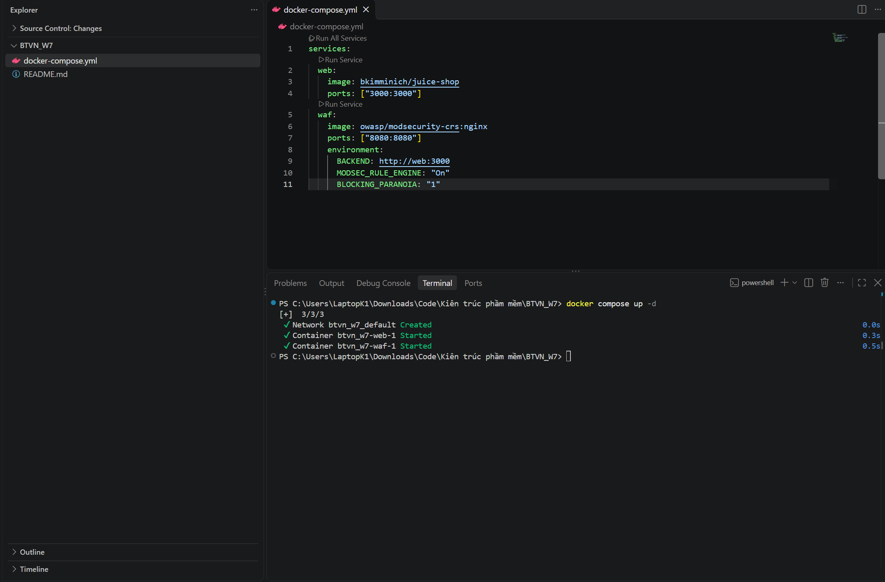
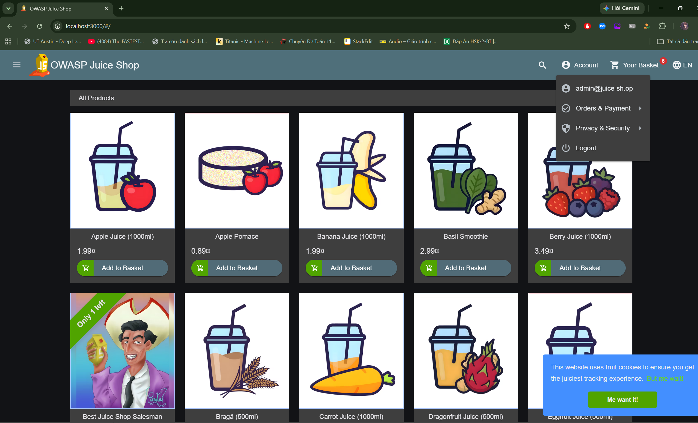
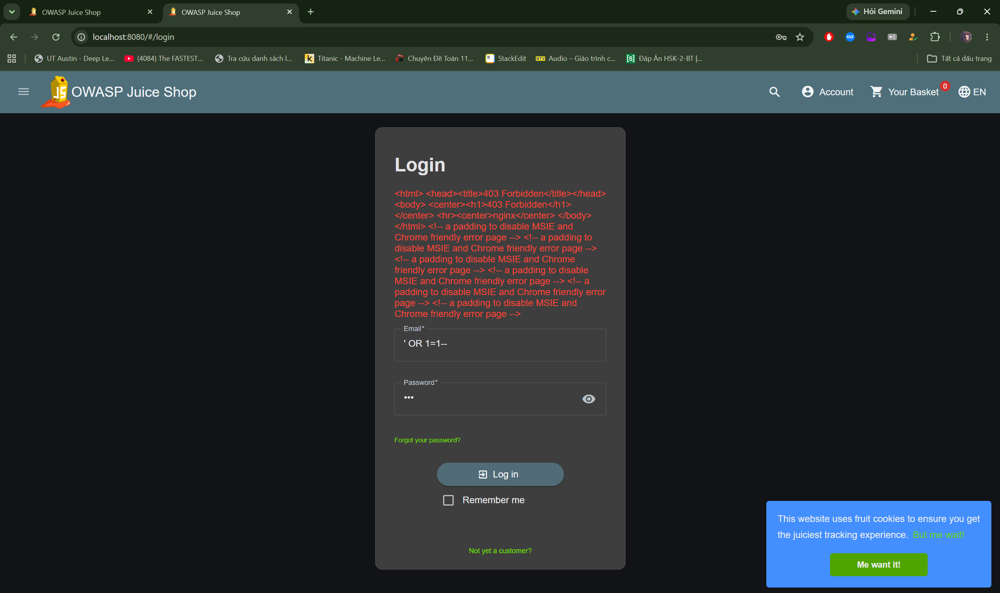
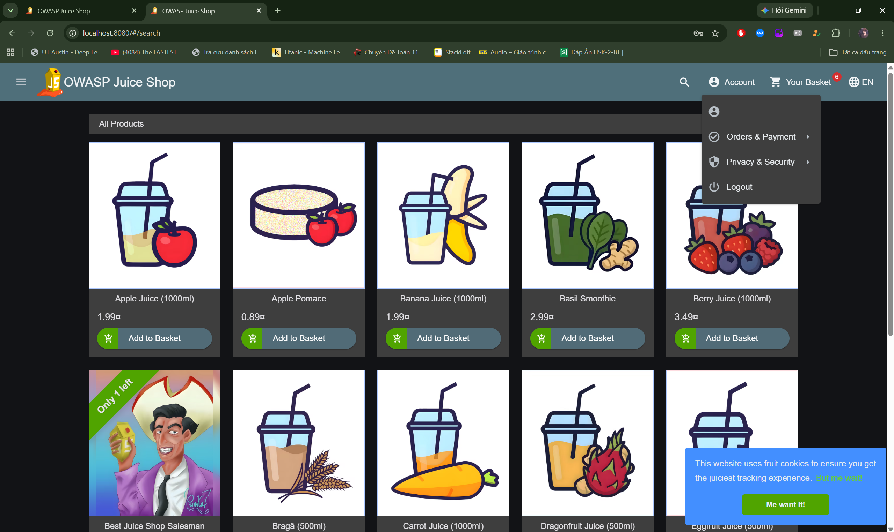

# Báo cáo thực hành: WAF trên Nginx

**Thông tin sinh viên:**

- **Họ và tên:** Nguyễn Xuân Tùng
- **MSSV:** 24021666

---

## 1. Mục tiêu và kiến trúc hệ thống

**Mục tiêu:** Dựng một hệ thống "người gác cổng" WAF (Nginx + ModSecurity + OWASP CRS) đứng trước một web bán hàng cố ý chứa lỗ hổng (OWASP Juice Shop) để kiểm thử khả năng ngăn chặn tấn công SQL Injection.

**Kiến trúc:**

- **Backend (Web):** Chạy trên cổng `3000` (Không có WAF bảo vệ).
- **Frontend (WAF):** Chạy trên cổng `8080`, nhận request từ client, kiểm tra qua ModSecurity, nếu an toàn sẽ đẩy về backend cổng `3000`.

---

## 2. Quá trình triển khai

### Bước 1: Khởi tạo hệ thống bằng Docker Compose

Tạo file `docker-compose.yml` định nghĩa 2 service `web` và `waf`. Bật tính năng `MODSEC_RULE_ENGINE: "On"` và mức độ kiểm tra `BLOCKING_PARANOIA: "1"`. Chạy lệnh `docker compose up -d` để khởi động.

> 

### Bước 2: Tấn công trực tiếp (Không qua WAF)

- **Thao tác:** Truy cập thẳng vào backend qua `http://localhost:3000`.
- **Payload:** Nhập Email là `' OR 1=1-- ` và Mật khẩu bất kỳ.
- **Kết quả:** Đăng nhập thành công vào tài khoản Admin do lỗ hổng SQL Injection không bị ngăn chặn.

> 

### Bước 3: Tấn công qua WAF (Cổng 8080)

- **Thao tác:** Truy cập qua WAF bằng đường dẫn `http://localhost:8080`.
- **Payload:** Nhập lại đúng Email `' OR 1=1-- ` và Mật khẩu bất kỳ.
- **Kết quả:** Trình duyệt trả về lỗi **403 Forbidden**. Cuộc tấn công đã bị WAF chặn đứng trước khi chạm tới Juice Shop.

> **Thêm ảnh chụp màn hình lỗi 403 Forbidden trên trình duyệt vào thư mục `images`:**
> 

### Bước 4: Kiểm tra đăng nhập hợp lệ

- **Thao tác:** Truy cập `http://localhost:8080` và dùng tài khoản hợp lệ (`admin@juice-sh.op` / `admin123`).
- **Kết quả:** Đăng nhập thành công, chứng minh WAF cấu hình đúng, chỉ chặn request độc hại và vẫn cho phép người dùng thật truy cập bình thường.

> 

### Bước 5: Phân tích Log của WAF

Sử dụng lệnh `docker compose logs waf` để trích xuất nhật ký hoạt động. Các log thu được chỉ ra rõ lý do chặn:

1.  **Rule 949110 (Inbound Anomaly Score Exceeded):** Điểm rủi ro tổng cộng của request vượt qua ngưỡng cho phép.
2.  **Rule 932260 (Remote Command Execution):** WAF phát hiện các ký tự đặc biệt khớp với mẫu tấn công thực thi lệnh/SQL injection thông qua payload `' OR 1=1-- `.
3.  **Rule 920420 (Protocol Enforcement):** WAF chặn các request có `Content-type: text/plain` do vi phạm chính sách định dạng dữ liệu an toàn.

---

## 3. Kết luận

Hệ thống WAF tích hợp ModSecurity và OWASP CRS trên Nginx hoạt động hiệu quả. Nó đã tự động nhận diện và chặn đứng hoàn toàn payload SQL Injection, bảo vệ an toàn cho ứng dụng Juice Shop ở phía sau mà không làm gián đoạn trải nghiệm của người dùng hợp lệ.
